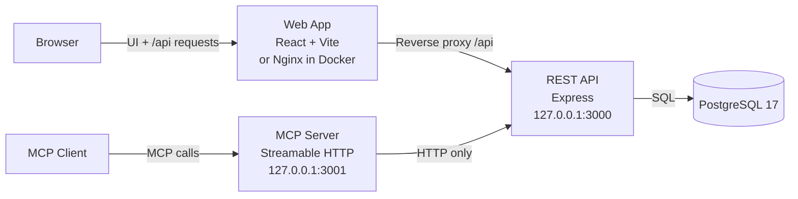

# GetHookd

GetHookd is a developer platform for discovering and analyzing advertising creatives. It combines a searchable REST API, a developer portal for managing API access, and an MCP server for AI agents.

This technical-assessment repository is an **npm-workspaces monorepo** with three applications (Web, API, and MCP) backed by PostgreSQL.

## Features

- **Ad discovery:** REST API with search filters, opaque cursor pagination, and ad details. The API supports a legacy `v0` contract and the current `v1` contract.
- **Developer Portal:** Sign in, create scoped API keys, revoke keys, and inspect monthly usage.
- **MCP tools:** `search_ads`, `get_ad`, and `list_niches` exposed over Streamable HTTP.
- **Shared API controls:** Authentication, scopes, rate limits, idempotency, and usage/billing are enforced by the REST API rather than duplicated in MCP.

**M5 status:** The MCP server and its three REST-backed tools are implemented. Each tool call forwards the caller's own `Authorization: Bearer <key>` to the REST API per request — no shared key or API bypass — so REST stays the sole authority for key validity, scopes, revocation, rate limits, and billing. Protocol tests exercise the tools against a controlled HTTP API fixture. Real-model evaluation evidence is the remaining M5 work. See [MCP Server](#mcp-server).

## Architecture



| Component | Responsibility |
| --- | --- |
| `apps/web` | React 19, TypeScript, and Vite SPA for login, API keys, and usage. Nginx serves the build and proxies `/api` in Docker. |
| `apps/api` | Express 5 REST API for auth, keys, search, ingestion, rate limits, metering, and billing; owns all database access through Drizzle ORM. |
| `apps/mcp` | Independent Node.js/TypeScript MCP server; communicates with the API over HTTP only and never accesses PostgreSQL directly. |
| PostgreSQL 17 | Stores users, API keys, brands, ads, and billing records. Schema migrations live in `apps/api/drizzle/`. |

The browser uses a same-origin `/api` proxy (Vite in development, Nginx in Docker). Portal routes use Bearer JWTs; `/api/v1` uses scoped Bearer API keys (`search:read`, `keys:manage`). `JWT_SECRET` signs JWTs and a separate `CURSOR_SECRET` signs pagination cursors.

## Quick Start

### Prerequisites

- Node.js **26.13.0** (see `.nvmrc`) and npm.
- Docker Engine / Docker Desktop and Docker Compose v2 (with `up --wait` support).
- Available ports: `5432` (database), `3000` (API), `5173` (Web), and `3001` if running MCP. The Docker Web server uses `8080`.
- No `.env` file is required for the local demo.

Start Docker first, then run from the repository root:

```sh
nvm use
npm ci
npm run setup
npm run dev
```

`npm run setup` starts **only PostgreSQL**, waits for it to become healthy, and applies committed migrations and repeatable demo seeding. It preserves existing data.

`npm run dev` starts **API and Web only**; it does not start PostgreSQL or MCP.

Open <http://localhost:5173> and sign in:

- **Username:** `demo`
- **Password:** `demo-password`

If Vite selects another port, use the URL printed in the terminal; its `/api` proxy still targets port `3000`.

### Run MCP (separate terminal)

With the API running:

```sh
npm run dev -w @gethookd/mcp
```

The Streamable HTTP endpoint is <http://127.0.0.1:3001/mcp>. MCP is **not** included in the root `npm run dev` command or in Docker Compose. See [MCP Server](#mcp-server) for client connection, tool inputs, and credential forwarding.

## Docker Demo (API + Web)

To build and run the database, one-shot setup, API, and Web services without installing Node.js on the host:

```sh
docker compose up --build
```

Open <http://localhost:8080> and use the same demo credentials. Startup waits for database health, successful migration/seed, and API health before starting Web. Published ports bind to loopback only.

MCP is **not** a Compose service in this branch. Run it separately on the host if needed.

```sh
docker compose down          # stops services; preserves the database volume
docker compose up --build    # rebuilds and starts services again
```

Avoid `docker compose down -v` unless you intend to delete the stored database data.

> The Docker configuration is for local evaluation, **not a hardened production deployment**. Never expose the public demo credentials or default secrets.

## Try It

1. **Developer Portal:** Sign in and inspect Overview, create an API key with `search:read` on the API keys view, copy its secret (shown only once), and inspect Usage. Keys can be permanently revoked.

2. **API health:** Check the running REST service:

   ```sh
   curl -i http://localhost:3000/api/health
   ```

3. **REST search access:** With a newly created `search:read` key stored in the `API_KEY` shell variable, try niche discovery:

   ```sh
   curl -H "Authorization: Bearer $API_KEY" http://localhost:3000/api/v1/niches
   ```

4. **MCP:** Connect a Streamable HTTP client to `http://127.0.0.1:3001/mcp` to discover the three tools. Each call must carry a stored API key in `Authorization: Bearer <key>`; the server forwards it unchanged to the REST API, which enforces the key's scope and quota. Integration tests exercise tool behavior against an HTTP fixture.

Keep revealed keys and JWTs private; do not commit them or paste them into issues.

## MCP Server

`apps/mcp` exposes GetHookd ad search to AI agents over **Streamable HTTP**, calling the REST API over HTTP only — never the database. It is stateless and loopback-bound: a fresh instance serves each request, and non-localhost `Host`/`Origin` requests get a `403` (DNS-rebinding protection).

**Authentication.** Each tool call forwards the caller's own `Authorization: Bearer <key>` to the matching REST request. There is no shared key or bypass, so REST remains the sole authority for key validity, scopes, revocation, rate limits, and billing. A missing, malformed, or duplicate header is rejected locally with `UNAUTHENTICATED` guidance and never reaches REST. Credentials are request-scoped — never stored, cached, logged, or placed in tool arguments or URLs.

### Run

With the API running (port `3000`):

```sh
npm run dev -w @gethookd/mcp                                      # watch mode
npm run build -w @gethookd/mcp && npm run start -w @gethookd/mcp  # build and start
```

The single endpoint is `POST http://127.0.0.1:3001/mcp`. MCP is **not** part of `npm run dev` or Docker Compose; run it separately. Configuration (`MCP_HOST`, `MCP_PORT`, `API_BASE_URL`) is read from the process environment — see [Configuration](#configuration).

### Connect a client

Point any Streamable HTTP MCP client at `http://127.0.0.1:3001/mcp`, passing your reveal-once `search:read` key as the Bearer credential. For Claude Code:

```sh
claude mcp add --transport http gethookd http://127.0.0.1:3001/mcp \
  --header "Authorization: Bearer <YOUR_API_KEY>"
```

The portal's **Connect Claude Code** panel shows this same template with a copy button. Prefer an environment reference (`Bearer $GETHOOKD_API_KEY`) over a literal key where your client supports it, and never commit a key.

### Tools

| Tool | Purpose | Inputs |
| --- | --- | --- |
| `search_ads` | Search ads and return compact summaries. | `q`, `niche[]`, `format`, `status`, `started_after`, `brand_id`, `sort`, `limit`, `cursor`, `idempotency_key` (all optional) |
| `get_ad` | Retrieve full details for one ad. | `id` (required), `idempotency_key` (optional) |
| `list_niches` | Discover valid niche slugs and display names. | none |

Tools follow the v1 search contract and preserve REST responses verbatim: omitted filters inherit REST normalization and cursor defaults, REST error envelopes pass through (`isError: true`), and MCP never retries automatically. A reused `idempotency_key` requests REST billing deduplication (not response replay); `list_niches` and failed reads are not billed.

**Limits (M5 deferrals).** There is no enforced response-size budget — search summaries and full ad details are reproduced verbatim, so large payloads can consume model context. Portal first-call detection, Playwright/browser E2E, and automated evaluation replay are deferred; real-model evaluation evidence (`docs/MCP_EVAL.md`) is the remaining M5 work. See [ADR-0005](docs/agents/adr/) for the shared-control rationale.

## Development

| Command | Purpose |
| --- | --- |
| `npm run setup` | Start database, apply migrations, and seed demo data |
| `npm run dev` | Run API and Web watchers |
| `npm run dev -w @gethookd/mcp` | Run MCP in watch mode |
| `npm test` | Run MCP protocol/HTTP tests, API unit and isolated PostgreSQL integration tests, and Web component tests |
| `npm run build` | Build/type-check all three workspaces |
| `npm run lint` / `npm run check` | Biome lint / formatting and lint checks |
| `npm run db:generate` / `npm run db:migrate` | Generate migrations / apply committed migrations |
| `npm run db:seed` | Seed the demo user, ad fixtures, and public API key |
| `npm run ingest` | Run the optional live-ingest job |
| `npm run db:studio` | Open Drizzle Studio (local `127.0.0.1:4983`) |

Integration tests provision disposable PostgreSQL through `compose.test.yaml`; Docker must be running.

### Switching between Docker and local development

If you previously ran the Docker demo, stop its API and Web services before starting local watchers (both use port `3000` for the API):

```sh
docker compose stop api web
npm run setup
npm run dev
```

If a portal route unexpectedly returns **404**, check `docker compose ps` and which service owns port `3000`. A healthy old Docker API may not expose the current routes. An unauthenticated `/api/portal/usage` request instead returns **401**, as expected. There is no need to delete the database volume to switch modes.

## Project Structure

```text
apps/
  api/               REST API, auth, search, ingestion, billing, database
  web/               React SPA and developer portal
  mcp/               Streamable HTTP MCP server, tools, and protocol tests
scripts/
  setup.mjs          Local database setup / migrate / seed
docs/
  agents/            Engineering and agent conventions
    adr/             Architecture Decision Records
  openapi/           REST API contracts
  sessions/          Milestone design-session transcripts
  DESIGN.md          Design overview and trade-offs
  AI_NOTES.md        Notes on how AI was used in this project
compose.yaml         Docker demo: db, setup, api, web
compose.test.yaml    Isolated PostgreSQL for integration tests
.env.example         Optional root API/Compose configuration
AGENTS.md            Contributor and agent conventions
```

## Configuration

The API and Compose use development defaults if no root `.env` exists. Copy `.env.example` to `.env` to override them:

| Variable | Purpose |
| --- | --- |
| `POSTGRES_USER`, `POSTGRES_PASSWORD`, `POSTGRES_DB` | PostgreSQL credentials and database |
| `DATABASE_URL` | Optional explicit PostgreSQL URL; otherwise derived from `POSTGRES_*` |
| `JWT_SECRET` | Signs portal JWTs (at least 32 UTF-8 bytes) |
| `CURSOR_SECRET` | Independently signs opaque pagination cursors (at least 32 UTF-8 bytes) |

MCP reads its configuration from its **process environment**, not automatically from the root `.env`:

| Variable | Default | Purpose |
| --- | --- | --- |
| `MCP_HOST` | `127.0.0.1` | MCP bind address |
| `MCP_PORT` | `3001` | MCP HTTP port |
| `API_BASE_URL` | `http://127.0.0.1:3000` | REST API origin for MCP calls |

The public defaults are **local development fixtures**. Changing `POSTGRES_*` does not reconfigure an existing PostgreSQL volume. See [`.env.example`](.env.example) for details.

## Documentation

- [Design overview and trade-offs - DESIGN.md](docs/DESIGN.md)
- [Notes on AI use - AI_NOTES.md](docs/AI_NOTES.md)
- [Agent conventions](docs/agents/) and [AGENTS.md](AGENTS.md)
- [OpenAPI contracts](docs/openapi/): [v1 REST](docs/openapi/v1.yaml) and [Portal](docs/openapi/portal.yaml)

Milestone specifications, plans, and progress are tracked in **GitHub Issues** as the source of truth.

## Unfinished Work

Remaining work is tracked in the repository's open [GitHub Issues](https://github.com/PavelDobranov/gethookd-assignment/issues?q=is%3Aissue+is%3Aopen). The core is the M5 real-model evaluation, which must be run and recorded before the milestone can be accepted:

- **Record the five-task baseline** ([#135](https://github.com/PavelDobranov/gethookd-assignment/issues/135)) — run the five evaluation prompts from specification #118 against real Claude Code, each in a fresh isolated session, and record prompts, first tool calls, errors, and first-try judgments in `docs/MCP_EVAL.md`.
- **Refine tool guidance from the baseline** ([#136](https://github.com/PavelDobranov/gethookd-assignment/issues/136)) — make focused tool description and error-wording improvements justified by the observed baseline, without changing REST contracts, response codes, billing identities, or the prompts.
- **Record the after-evaluation and finalize evidence** ([#137](https://github.com/PavelDobranov/gethookd-assignment/issues/137)) — rerun the same five tasks after refinements, record all ten scored outcomes honestly (including any unmet requirements), and link the evidence from this README with remaining gaps in priority order.
- **Final specification acceptance** ([#138](https://github.com/PavelDobranov/gethookd-assignment/issues/138)) — human review checkpoint for specification #118 and all recorded limitations before closure.
- **Usage-refresh focus test failure** ([#139](https://github.com/PavelDobranov/gethookd-assignment/issues/139)) — a reproducible web test failure (`apps/web/tests/usage.test.tsx`): the Refresh usage button loses focus after a refresh. Diagnose whether the cause is browser behavior, jsdom/user-event scheduling, or the test expectation, and fix it without weakening the focus assertion.

**Deferred by explicit decision** (out of scope for this assessment): an enforced MCP response-size budget, portal first-call detection, Playwright/browser E2E, and automated evaluation replay — see the [MCP Server](#mcp-server) limits.
